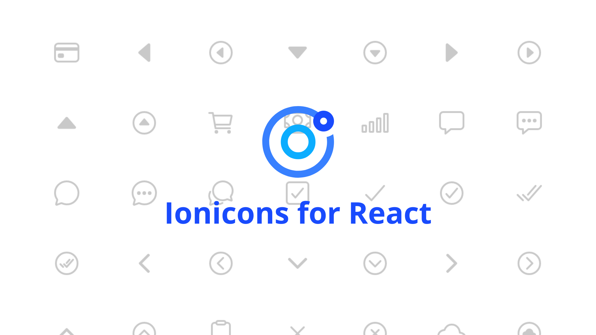

# Componente React de Ionicons



Este paquete contiene un componente de React que implementa la última versión oficial de [Ionicons](https://github.com/ionic-team/ionicons) para React.

## Instalación 📦

Para agregar el paquete a tu proyecto existente de React, simplemente escribe uno de los siguientes comandos:

```
npm i @reacticons/ionicons
```

o

```
yarn add @reacticons/ionicons
```

## Uso

```js
import React from 'react';
import IonIcon from '@reacticons/ionicons';

export const Component = () => (
  <>
    <IonIcon name="bag-outline" />
  </>
);
```

### Tamaño personalizado

Puedes especificar el tamaño del ícono utilizando la prop opcional `size`.

```js
<IonIcon name="bag-outline" size="small" />
<IonIcon name="bag-outline" size="large" />
```

## Iconos compatibles

Este paquete es compatible con todos los iconos de Ionicons de la versión correspondiente. Para ver una lista completa, puedes consultar el [sitio web oficial de Ionicons](https://ionicons.com/).

## Nota

Por cierto, el componente `<IonIcon>` tiene los mismos atributos que un elemento `<span>` típico.
